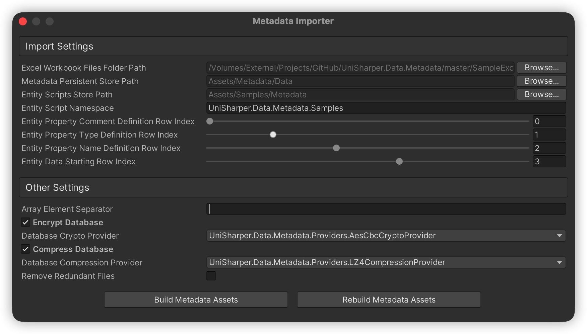

# UniSharper.Data.Metadata

[](LICENSE.md)
[](https://unity.com/)
[](https://github.com/iDreamsOfGame/UniSharper.Data.Metadata)
[](https://openupm.com/packages/io.github.idreamsofgame.unisharper.data.metadata/)

UniSharper.Data.Metadata is a library for converting data in Excel workbook files (*.xls, *.xlsx) into metadata database files, and reading them at runtime in Unity Engine.

The Excel data can be imported in two ways:

- **In the Unity Editor** — the built-in *Metadata Importer* window generates metadata entity scripts and the database files.
- **Outside the Unity Editor** — the `MetadataDatabaseFileGenerator` class generates the database files directly (e.g. from a cross-platform console program), without generating entity scripts.

All database files are read at runtime by the `MetadataManager` class.

## Features

- Imports the first worksheet of an Excel workbook file as a metadata table.
- Generates a standalone iBoxDB database file (*.db.bytes) per metadata entity, plus a shared configuration database file.
- Supports primitive types, one-dimensional arrays, custom enums and Unity types (`Vector2`, `Vector3`, `Quaternion`, `Rect`, `Color`, etc.) with optional encryption (AES-CBC) and compression (Deflate/LZ4).
- Optional entity script generation in the Unity Editor, with incremental (snapshot based) imports.
- Works inside the Unity Editor and in plain .NET console programs.

## Requirements

- Unity **2021.3** or newer (only needed for the editor tool and the runtime; the generator itself runs on .NET 6/8).
- Dependencies (installed automatically by the Unity Package Manager):
  - `io.github.idreamsofgame.unisharper.core` 2.0.6
  - `io.github.idreamsofgame.resharp.data.iboxdb` 3.0.0
  - `com.github.exceldatareader.exceldatareader` 3.6.0

## Installation

### Install via Git URL

Add the package by Git URL in Unity: **Edit → Project Settings → Package Manager → + → Add package from git URL**, or add it to the `manifest.json` of your project:

```json
{
  "dependencies": {
    "io.github.idreamsofgame.unisharper.data.metadata": "https://github.com/iDreamsOfGame/UniSharper.Data.Metadata.git?path=Assets/UniSharper.Data.Metadata"
  }
}
```

> The `?path=` query points the Package Manager to the package folder inside the repository.

### Install via OpenUPM

The package is available on the [OpenUPM](https://openupm.com/) registry. Add the scoped registry to the `manifest.json` of your project:

```json
{
  "scopedRegistries": [
    {
      "name": "OpenUPM",
      "url": "https://package.openupm.com",
      "scopes": [
        "io.github.idreamsofgame"
      ]
    }
  ],
  "dependencies": {
    "io.github.idreamsofgame.unisharper.data.metadata": "3.5.1"
  }
}
```

Or install it with the [openupm-cli](https://github.com/openupm/openupm-cli):

```sh
openupm add io.github.idreamsofgame.unisharper.data.metadata
```

## The Excel Workbook Format

The first worksheet of an Excel workbook file is imported as one metadata table. By default the first four rows define the table layout (each row index is configurable):

| Row | Index | Content |
| --- | --- | --- |
| Comment | 0 | The comment of each property, e.g. `ID`, `Player Name` |
| Type | 1 | The type of each property, e.g. `long`, `string`, `Vector2` |
| Name | 2 | The name of each property, e.g. `Id`, `Name` |
| Data | 3+ | The entity data rows |

Columns with an empty name or an empty type are ignored.

### Supported Property Types

| Category | Types |
| --- | --- |
| Primitives | `string`, `bool`, `byte`, `sbyte`, `short`, `ushort`, `int`, `uint`, `long`, `ulong`, `float`, `double`, `decimal` |
| Arrays | `<type>[]`, e.g. `string[]`, `int[]`, `float[]` |
| Custom enums | `enum` — the value list is collected from the data cells, the stored value is the index of the value (`None` is `0`) |
| Unity types | `Vector2`, `Vector2Int`, `Vector3`, `Vector3Int`, `Vector4`, `RangeInt`, `Quaternion`, `Rect`, `RectInt`, `Color`, `Color32` |
| Unity type arrays | `Vector2[]`, `Vector2Int[]`, `Vector3[]`, `Vector3Int[]`, `Vector4[]`, `RangeInt[]`, `Quaternion[]`, `Rect[]`, `RectInt[]`, `Color[]`, `Color32[]` |

Array elements and Unity type components in a cell are delimited by a configurable separator (default `|`), e.g. `1|2|3` or `(1.0, 2.0)|(3.0, 4.0)`.

## Using the Metadata Importer (Unity Editor)

Open the tool from the menu **UniSharper → Metadata Management → Metadata Importer**.



### Import Settings

- **Excel Workbook Files Folder Path** — the folder that is scanned recursively for *.xls and *.xlsx files.
- **Metadata Persistent Store Path** — the folder where the generated database files are saved.
- **Entity Scripts Store Path** — the folder where the metadata entity scripts are generated.
- **Entity Script Namespace** — the namespace of the generated entity scripts.
- **Entity Property Comment/Type/Name Definition Row Index** and **Entity Data Starting Row Index** — the row layout described above.
- **Array Element Separator** — the character that delimits array elements and Unity type components in cells.

### Other Settings

- **Encrypt Database** — encrypts the database files, with a selectable **Database Crypto Provider** (default `AesCbcCryptoProvider`).
- **Compress Database** — compresses the database files, with a selectable **Database Compression Provider** (default `DeflateCompressionProvider`, `LZ4CompressionProvider` is also available).
- **Remove Redundant Files** — removes the database files and entity scripts of deleted Excel workbook files.

### Building

- **Build Metadata Assets** — generates the entity scripts for new or changed Excel workbook files, compiles them and writes the database files.
- **Rebuild Metadata Assets** — clears the import snapshot and rebuilds everything.

The output is written to the persistent store folder: one `{EntityName}.db.bytes` per Excel workbook file (named after the file) plus the shared `MetadataEntityDBConfig.db.bytes` configuration database. Entity scripts are partial classes derived from `MetadataEntity` and can be extended freely.

### Reading the Generated Data at Runtime

The generated `*.db.bytes` files are Unity binary assets (`TextAsset`). At runtime, initialize the `MetadataManager` with the **configuration database data** (`MetadataEntityDBConfig.db.bytes`) first, then load the entity database data and read the entities through the query APIs:

```csharp
using UniSharper.Data.Metadata;
using UniSharper.Data.Metadata.Providers;
using UnityEngine;

public class MetadataSample : MonoBehaviour
{
    [SerializeField]
    private TextAsset configDatabaseAsset;

    [SerializeField]
    private TextAsset playerDatabaseAsset;

    private void Awake()
    {
        // The providers must match the ones selected at build time
        // (skip this if you keep the default AesCbcCryptoProvider and DeflateCompressionProvider).
        MetadataManager.Instance.CompressionProvider = new LZ4CompressionProvider();

        // Initialize the MetadataManager with the configuration database data.
        MetadataManager.Instance.Initialize(configDatabaseAsset.bytes);

        // Load the entity database data.
        MetadataManager.Instance.LoadEntityDatabase<PlayerMetadata>(playerDatabaseAsset.bytes);
    }

    private void Start()
    {
        var player = MetadataManager.Instance.GetEntity<PlayerMetadata>(1L);
        var allPlayers = MetadataManager.Instance.GetAllEntities<PlayerMetadata>();
        var foundPlayers = MetadataManager.Instance.FindEntities<PlayerMetadata>("TypeValue", 1);
        var count = MetadataManager.Instance.Count<PlayerMetadata>();
    }

    private void OnDestroy()
    {
        MetadataManager.Instance.Dispose();
    }
}
```

The `TextAsset` references can be assigned in the Inspector, or the assets can be loaded by `Resources.Load` / Addressables — any source that provides the raw `byte[]` of the generated files works. Besides `GetEntity`, `GetAllEntities`, `FindEntities` and `Count`, the `MetadataManager` also provides `GetEntities`, `QueryEntities` and `CountByQuery` for key-value pair and query string based access. See the `MetadataSample` script in the `Samples` folder for a complete example.

## Generating Database Files Without the Unity Editor

`MetadataDatabaseFileGenerator` (namespace `UniSharperEditor.Data.Metadata`, in the *UniSharper.Data.Metadata.Editor* assembly) generates the same database files directly from Excel workbook files — **no entity scripts and no domain reload are needed**. Instead of compiled entity classes it creates the entity types dynamically with C# Reflection.Emit, so a generation run only takes milliseconds.

### Setting Up a Console Program

1. Create a .NET console project (e.g. `net8.0`).
2. Reference the Unity compiled assemblies from your project's `Library/ScriptAssemblies/` folder: `UniSharper.Data.Metadata.dll`, `UniSharper.Data.Metadata.Editor.dll`, `UniSharper.dll`, `UniSharper.Editor.dll`, plus the package DLLs from `Library/PackageCache/` (`ReSharp.Core.dll`, `ReSharp.Extensions.dll`, `ReSharp.Security.Cryptography.dll`, `ReSharp.Data.iBoxDB.dll`, `iBoxDB.NET2.dll`, `ExcelDataReader.dll`, `ExcelDataReader.DataSet.dll`, and the BouncyCastle DLL).
3. Provide a minimal set of Unity API stub assemblies (`UnityEngine.CoreModule`, `UnityEditor`, `UnityEditor.CoreModule`) that replace the real engine DLLs at runtime — the generator only touches a handful of editor APIs (progress bar, `ScriptableObject`, `Debug` logging). See the [`MetadataDatabaseFileGeneratorTest`](MetadataDatabaseFileGeneratorTest/) console project in this repository for a complete, working example including the stubs.
4. Register the code pages encoding provider (required by ExcelDataReader on .NET Core) and prefer the invariant culture.

### Generating Database Files

```csharp
using System.Globalization;
using UniSharper.Data.Metadata.Providers;
using UniSharperEditor.Data.Metadata;

System.Text.Encoding.RegisterProvider(System.Text.CodePagesEncodingProvider.Instance);
CultureInfo.DefaultThreadCurrentCulture = CultureInfo.InvariantCulture;

// Describes the Excel workbook layout.
var options = new ExcelDataParseOptions(
    entityPropertyCommentRowIndex: 0,
    entityPropertyTypeRowIndex: 1,
    entityPropertyNameRowIndex: 2,
    entityDataStartingRowIndex: 3,
    arrayElementSeparator: '|');

// Generates one database file from a single Excel workbook file (encrypted + compressed).
MetadataDatabaseFileGenerator.GenerateDatabaseFile(
    "Assets/Metadata/ExcelFiles/Player.xlsx",
    "Build/Metadata",
    options,
    shouldEncryptDatabase: true,
    shouldCompressDatabase: true);

// Generates database files for all Excel workbook files in a folder (plain).
MetadataDatabaseFileGenerator.GenerateDatabaseFiles(
    "Assets/Metadata/ExcelFiles",
    "Build/Metadata",
    options,
    shouldEncryptDatabase: false,
    shouldCompressDatabase: false);
```

Both methods return `true` when all database files were generated successfully. Custom provider instances can be passed with the optional `cryptoProvider` / `compressionProvider` parameters; when omitted, the default `AesCbcCryptoProvider` and `DeflateCompressionProvider` are used.

### Output

For every Excel workbook file named `Player.xlsx` the generator writes:

- `Player.db.bytes` — the metadata database of the entity.
- `MetadataEntityDBConfig.db.bytes` — the shared configuration database that maps each table name to its primary key (required at runtime).

## Reading Metadata at Runtime

Load the generated files with `MetadataManager` (namespace `UniSharper.Data.Metadata`) and read the entities:

```csharp
// Load the configuration database once, then the entity databases.
MetadataManager.Instance.Initialize(configDatabaseData);
MetadataManager.Instance.LoadEntityDatabase<PlayerMetadata>(playerDatabaseData);

var player = MetadataManager.Instance.GetEntity<PlayerMetadata>(1);
var allPlayers = MetadataManager.Instance.GetAllEntities<PlayerMetadata>();
```

`MetadataManager.CryptoProvider` and `MetadataManager.CompressionProvider` must match the providers used to generate the files (the defaults are `AesCbcCryptoProvider` and `DeflateCompressionProvider`). For encrypted or compressed files the entity class properties must mirror the Excel column names — use the entity scripts generated by the importer, or create the same properties in your own classes.

## License

[MIT](LICENSE.md) © [iDreamsOfGame](https://github.com/iDreamsOfGame)
